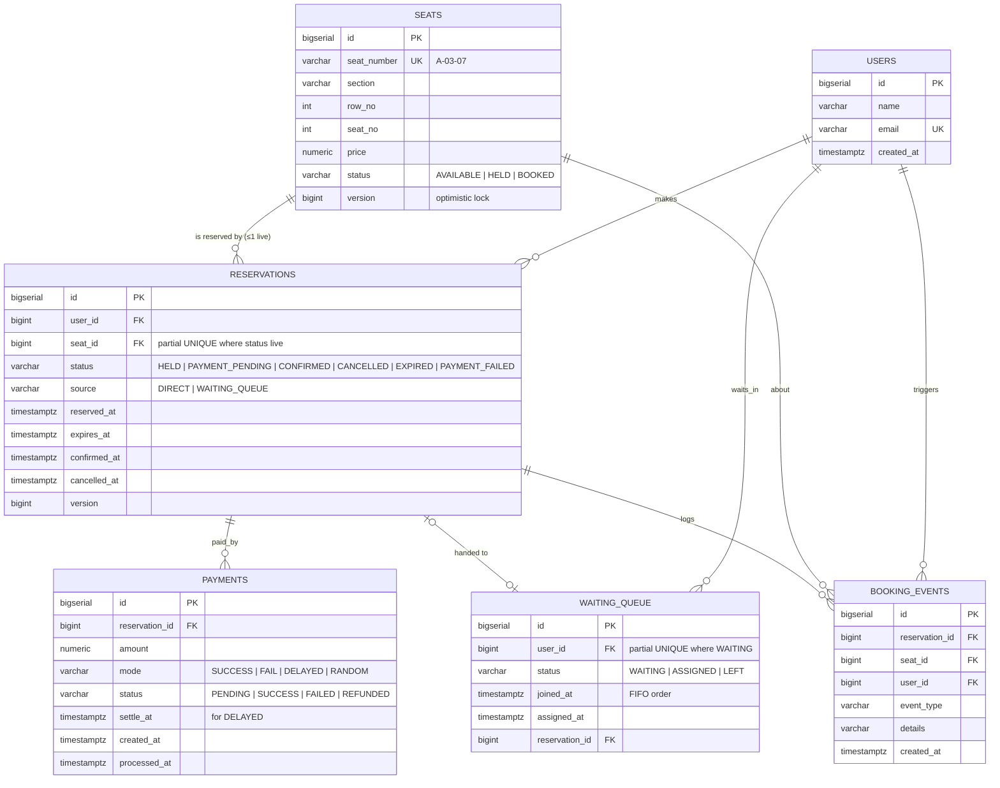
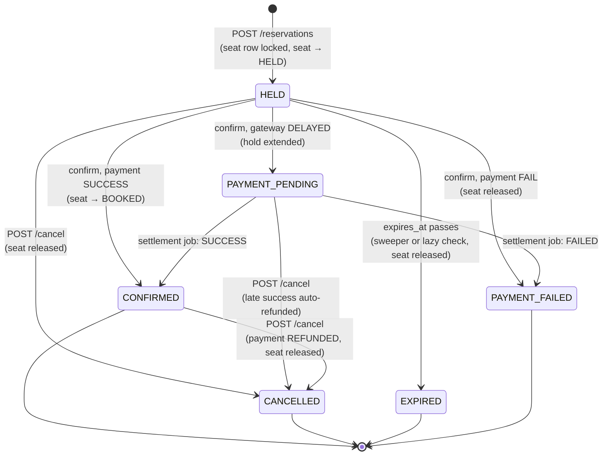
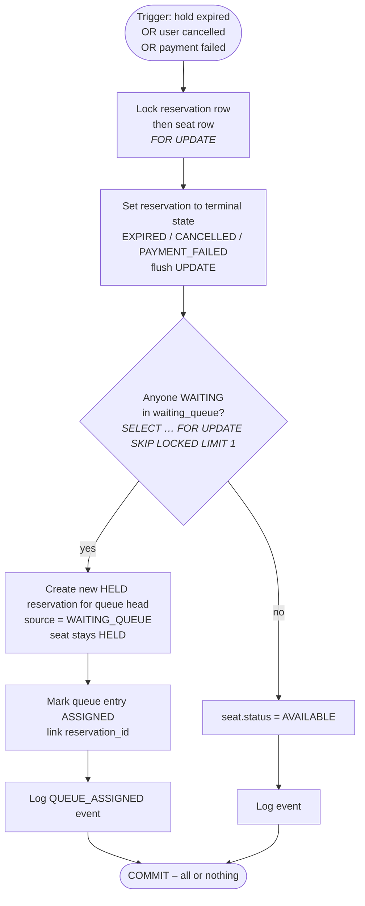

# Diagrams

Both diagrams are written in [Mermaid](https://mermaid.js.org) and render directly on GitHub,
GitLab, VS Code (Markdown Preview Mermaid extension) and https://mermaid.live.

## 1. Entity-Relationship Diagram



Key constraints that enforce correctness at the database layer:

| Constraint | Purpose |
|---|---|
| `uq_reservations_live_seat` – `UNIQUE (seat_id) WHERE status IN ('HELD','PAYMENT_PENDING','CONFIRMED')` | **At most one live reservation per seat, ever.** The last line of defence against double booking. |
| `uq_waiting_queue_user_waiting` – `UNIQUE (user_id) WHERE status = 'WAITING'` | A user cannot occupy two places in the queue. |
| `seats.version`, `reservations.version` | JPA optimistic locking; a stale write fails instead of silently overwriting. |
| `idx_reservations_expiry` (partial, on `expires_at WHERE status='HELD'`) | The expiry sweep touches only live holds. |

## 2. Booking workflow

### 2a. Reservation state machine



### 2b. Concurrent reserve: two students, one seat

```mermaid
sequenceDiagram
    autonumber
    participant A as Student A
    participant B as Student B
    participant API as Spring Boot<br/>BookingService
    participant PG as PostgreSQL

    par both click seat A-01-01 at 18:00:00.000
        A->>API: POST /api/reservations {seat 1}
        B->>API: POST /api/reservations {seat 1}
    end
    API->>PG: BEGIN; SELECT * FROM seats WHERE id=1 FOR UPDATE  (txn A)
    API->>PG: BEGIN; SELECT * FROM seats WHERE id=1 FOR UPDATE  (txn B)
    Note over PG: txn B blocks – row is locked by txn A
    PG-->>API: seat.status = AVAILABLE (txn A)
    API->>PG: UPDATE seats SET status='HELD', version=version+1 WHERE id=1
    API->>PG: INSERT INTO reservations (user A, seat 1, HELD, expires_at=now()+120s)
    Note over PG: partial unique index uq_reservations_live_seat passes (first live row)
    API->>PG: COMMIT (txn A)
    API-->>A: 201 Created  {status: HELD, secondsRemaining: 120}
    Note over PG: lock released → txn B wakes up and re-reads the row
    PG-->>API: seat.status = HELD (txn B)
    API->>PG: ROLLBACK (txn B)
    API-->>B: 409 Conflict  "Seat A-01-01 is already held"
```

### 2c. Seat release and reallocation (expiry / cancel / failed payment)



### 2d. End-to-end user journey

```mermaid
flowchart LR
    U[Student] -->|POST /api/users| R[Registered]
    R -->|GET /api/seats| V[View seat map]
    V -->|seat AVAILABLE?| D{ }
    D -- yes --> RS[POST /api/reservations<br/>201 HELD, 120 s timer]
    D -- no, atCapacity --> WQ[POST /api/queue/join<br/>position N]
    WQ -.->|seat freed → auto hold| RS
    RS -->|POST /confirm<br/>paymentMode| P{Payment}
    P -- SUCCESS --> CF[CONFIRMED ✓]
    P -- FAIL --> PF[PAYMENT_FAILED<br/>seat reallocated]
    P -- DELAYED --> PP[PAYMENT_PENDING<br/>settled by job in ~15 s] --> P
    RS -->|timer runs out| EX[EXPIRED<br/>seat reallocated]
    RS -->|POST /cancel| CA[CANCELLED<br/>seat reallocated]
    CF -->|POST /cancel| CA
    CF & PF & EX & CA -->|GET /api/users/{id}/bookings| HI[Booking history]
```
